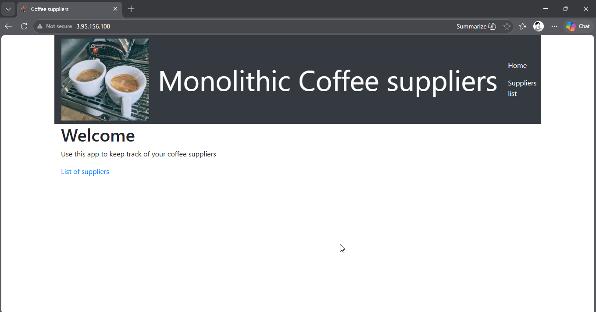
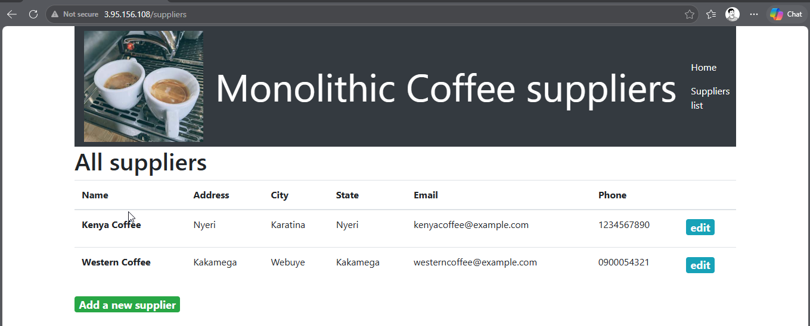
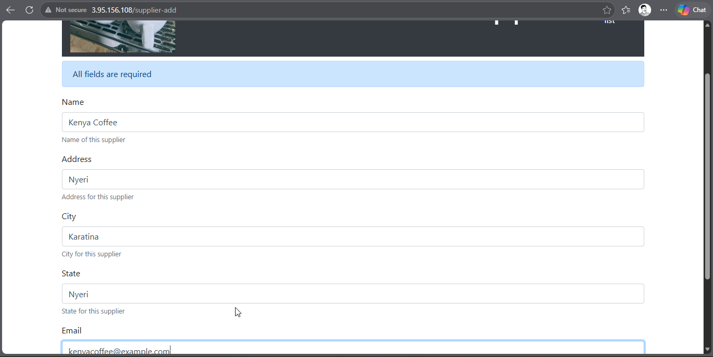
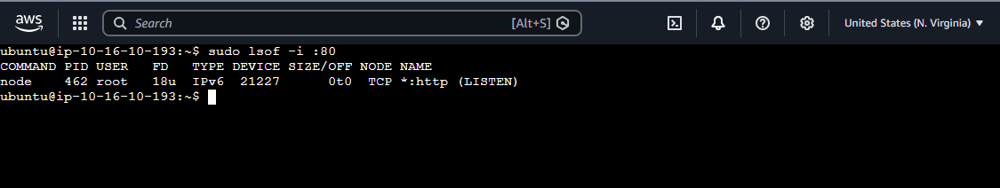
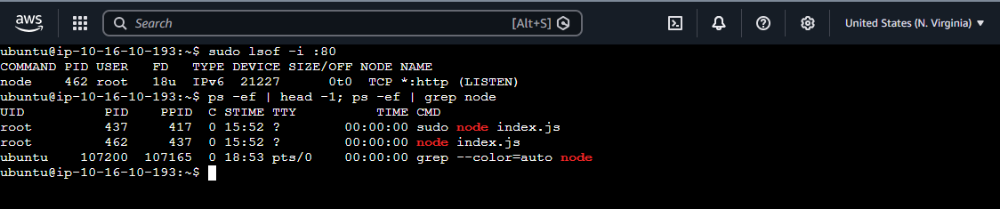
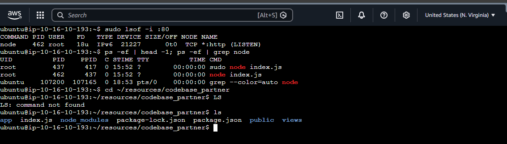
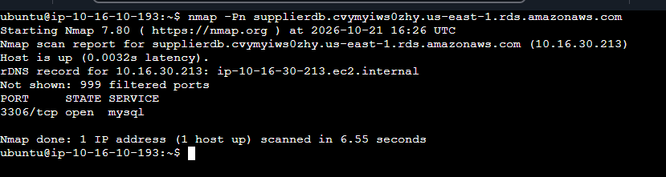
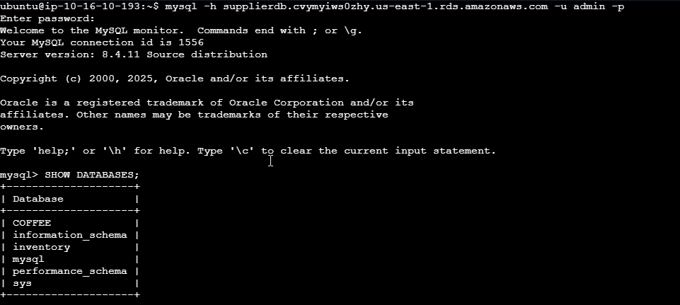
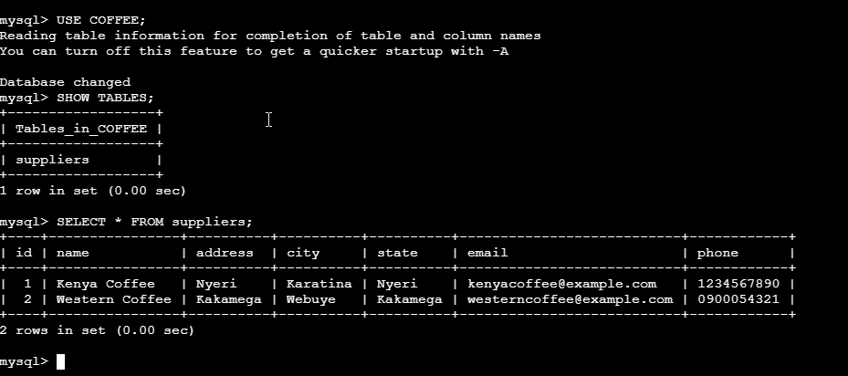

# Monolithic Application Analysis and Testing on AWS

## 1. Overview

On Phase 2, I focused on analyzing the existing monolithic coffee supplier application running in the AWS lab environment.

The application is built with Node.js and uses an Amazon Relational Database Service (Amazon RDS) MySQL database to store supplier information. Before redesigning the application into microservices, I needed to understand how the existing application works, how users interact with it, how its backend processes requests, and where its data is stored.

This phase establishes the technical foundation for the subsequent stages of the project, where the application will be divided into separate customer and employee microservices, containerized with Docker, and eventually deployed through an automated CI/CD pipeline.

The activities documented here follow Phase 2 of the supplied AWS project guide.

## 2. Objectives

The objectives of this practical session were to:

- Verify that the existing monolithic application is accessible over the internet.
- Test the application's main supplier-management functions.
- Observe the URL paths used by different application pages.
- Connect to the EC2 instance hosting the application.
- Investigate the Node.js process and its network port.
- Inspect the application source-code directory.
- Identify the Amazon RDS database endpoint.
- Verify connectivity between the application server and the database.
- Inspect the `COFFEE` database and its `suppliers` table.
- Document the findings that will guide the microservices architecture.

## 3. Existing Application Architecture

The initial application uses a monolithic architecture. Its application logic runs as a Node.js process on an Amazon EC2 instance, while supplier records are stored in a separate MySQL database hosted by Amazon RDS.

### Architecture components

| Component | Purpose |
|---|---|
| User's web browser | Accesses the coffee supplier application |
| Amazon EC2 | Hosts the Node.js application |
| Node.js | Handles application requests and business logic |
| Amazon RDS | Hosts the relational database |
| MySQL | Stores supplier information |
| AWS VPC | Provides the network environment for AWS resources |

### Architecture flow

```text
User's Web Browser
        |
        | HTTP request
        v
Public IPv4 Address
        |
        v
Amazon EC2 Instance
(MonolithicAppServer)
        |
        v
Node.js Application
        |
        | MySQL connection
        v
Amazon RDS
        |
        v
COFFEE Database
        |
        v
suppliers Table
```

**Architecture observation:** The application and database are separate infrastructure components, but the application's functional components are still combined within one application codebase and runtime.

The purpose of the wider project is to separate the application functionality into independently deployable microservices.

## 4. Verify Application Availability

### Objective

Verify that the existing coffee supplier web application can be accessed through the public IPv4 address of the `MonolithicAppServer` EC2 instance.



The coffee supplier web application loaded and displayed its user interface.


## 5. Test the Monolithic Web Application

### Objective

Test the existing application to understand its functionality and identify the URL paths used for supplier operations.

### 5.1 View the supplier list

The URL path should include:

```text
/suppliers
```


This route displays the supplier records stored in the application database.


### 5.2 Add a supplier

The path should include:

```text
/supplier-add
```



### 5.3 Edit an existing supplier

The path should include:

```text
/supplier-update/1
```


### Functional testing summary

| Test | Expected result | Actual result |
|---|---|---|
| Open supplier list | Supplier records are displayed | Record during lab |
| Add supplier | New supplier is saved | Record during lab |
| Edit supplier | Updated values are saved | Record during lab |
| Observe application routes | Relevant URL paths are identified | Record during lab |

## 6. Analyze How the Application Runs

### Objective

Connect to the EC2 instance and investigate the running Node.js application, its network listener, its source-code location, and its database connection.

### 6.1 Connect to the EC2 instance connect

The following commands are intended for the Linux shell on the application server.

### 6.2 Identify the process listening on port 80

Run:

```bash
sudo lsof -i :80
```

This command lists processes associated with network activity on port 80.

Inspect the output for the process name, process ID, user, and listening socket information.

For this application, the web service is expected to receive HTTP traffic on port 80.

Port 80 is the conventional TCP port for HTTP. The command output should be examined to verify the actual listener rather than assuming that every process named Node.js uses the same port.



### 6.3 Inspect Node.js processes

Run:

```bash
ps -ef | head -1
ps -ef | grep node
```

The commands serve two purposes:

- `ps -ef | head -1` displays the process-list column headings.
- `ps -ef | grep node` searches the process list for entries containing `node`.



Inspect the output to identify:

- The user running the Node.js process.
- The process ID.
- The command associated with the process.
- Whether the PID matches the relevant process reported by `lsof`.


**Important:** The `grep node` command has also displayed its own process on PID 437. Distinguish the actual Node.js application process from the search command.


### 6.4 Inspect the application source-code directory

Run:

```bash
cd ~/resources/codebase_partner
ls
```

This directory contains the supplied application code. The main application entry point identified by the lab guide is `index.js`.


#### Questions for thought

1. Where and how is the Node app running?	Directly on the EC2 host as a Node.js process listening on port 80. It is not containerized.
2. How was it installed?	Node.js and the application's npm dependencies were installed on the instance itself.
3. What prerequisites were required?	The Node.js runtime and the npm packages used by the application (such as Express and the MySQL client library).
4. Where does the application store data?	In an Amazon RDS MySQL database, not on the EC2 instance.


## 7. Connect to the RDS database
Copied the RDS endpoint from the Amazon RDS console.
Checked that the database is reachable on the standard MySQL port:
bash
   nmap -Pn <RDS-ENDPOINT>



Connected with the MySQL client already installed on the instance (username admin, password provided by the lab):
bash
   mysql -u admin -p -h <RDS-ENDPOINT>



sql
SHOW DATABASES;
USE COFFEE;
SHOW TABLES;
SELECT * FROM suppliers;




The COFFEE database contains a suppliers table holding the supplier records I added in Task 5.2.

Exited the client with exit, then closed the Instance Connect tab and the web application tab.

## 8. Key Findings
The application is a monolith: one Node.js process on one EC2 instance serves every page.
It listens on TCP port 80. In Phase 4 it will move to port 8080 inside containers.
Read and write routes are in the same codebase, so they can be separated into customer (read-only) and employee (read-write) services.
Data lives in RDS MySQL, so both microservices can keep sharing one database.
The application finds its database through configuration, which will be supplied to containers through the APP_DB_HOST environment variable.

## 9. Security Notes
The site runs over plain HTTP, and the traffic is unencrypted. This is acceptable only in the lab. A production deployment should terminate TLS (HTTPS) at the load balancer.
Database credentials are provided by the lab for this exercise only. Real credentials should be kept in a secrets manager and never committed to a repository.
Public IP addresses, database endpoints, and account IDs are redacted in this write-up. Screenshots committed to a public repository should be checked for them before pushing.