# Phase 4: Configuring the Application as Two Microservices and Testing Them in Docker Containers

## Project metadata

  -----------------------------------------------------------------------
  Field                               Details
  ----------------------------------- -----------------------------------
  Project                             Building Microservices and a CI/CD
                                      Pipeline in AWS

  Phase                               Phase 4

  Environment                         AWS VocLabs / AWS Cloud9

  Cloud provider                      Amazon Web Services

  Runtime and framework               Node.js / Express

  Container technology                Docker

  Source control                      Git and AWS CodeCommit

  AWS Region                          `us-east-1`

  Repository / branch                 `microservices` / `dev`
  
  -----------------------------------------------------------------------


## 1. Introduction and objectives

Phase 4 adapts two copies of the original monolithic coffee-supplier
application into two application services with different
responsibilities. The work is performed in AWS Cloud9, using Docker to
package and test each Node.js application and AWS CodeCommit to store
the source changes.

The **customer microservice** provides read-oriented supplier browsing.
Customers need supplier contact information, but should not be offered
the supplier add/edit/delete workflow.

The **employee microservice** retains supplier administration
functionality, including listing, adding, editing, and deleting
suppliers.

Both applications use the existing Amazon RDS database. They are
separate application codebases and Docker images, not separate
databases.

The employee container was initially tested on port `8081`. Task 4.6
changed the employee application's default port and Dockerfile
declaration to `8080` in preparation for the later ECS deployment phase.
After rebuilding the image, the previous employee test container was
removed and no replacement container was launched, in accordance with
the project guide.

### Objectives

1.  Allow browser access to the Cloud9 test ports.
2.  Remove customer-side supplier write functionality.
3.  Build and test the customer Docker image against the existing
    database.
4.  Retain employee supplier-administration routes and views.
5.  Build and initially test the employee image on port `8081`.
6.  Change the employee image configuration to port `8080` and rebuild
    it.
7.  Commit and push the source changes to the `dev` branch in
    CodeCommit.

## 2. Architecture overview

The diagram represents the Phase 4 test setup, not the final production
architecture.

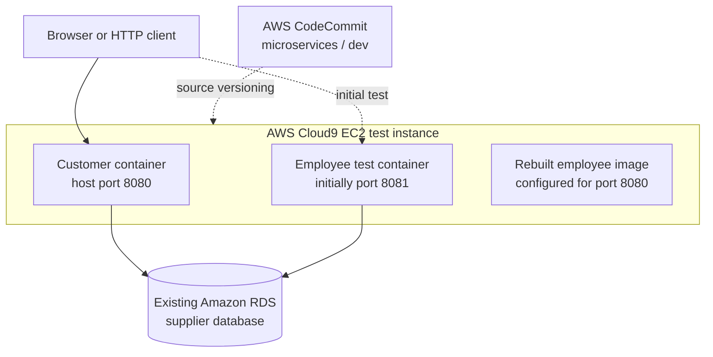

The customer container was verified running on host port `8080`. The
employee container was tested on port `8081` before the employee image
was rebuilt for port `8080`. The final employee image is not the same
thing as a running employee container.

This phase does not establish that Amazon ECR, Amazon ECS, an
Application Load Balancer, or a CI/CD pipeline has been deployed; those
are later phases.

## 3. Task 4.1: Adjust the AWS Cloud9 instance security group settings

### Objective

Allow inbound TCP traffic on ports `8080` and `8081` so the test
applications can be accessed from a browser.

### Procedure

1.  Open the EC2 console in the lab account and region.
2.  Locate the EC2 instance associated with the Cloud9 environment.
3.  Identify the security group attached to that instance.
4.  Edit its inbound rules and add TCP ports `8080` and `8081`.
5.  Save the rules and confirm that they apply to the correct instance.
6.  Restrict the source to the narrowest suitable range for the lab,
    such as the tester's public IP address, where feasible.

Port `8080` was used by the customer container and later became the
employee image's configured application port. Port `8081` was used for
the initial employee-container test.


## 4. Task 4.2: Modify the source code of the customer microservice

### Controller

File: `customer/app/controller/supplier.controller.js`

The controller was reduced to the read-oriented `findAll` and `findOne`
functions. The create, update, remove, and remove-all controller
operations were removed. The retained functions use `Supplier.getAll`
and `Supplier.findById`.


### Model

File: `customer/app/models/supplier.model.js`

The model retains `Supplier.getAll` and `Supplier.findById`. Create,
update, delete, and bulk-delete functionality was removed from the
customer model.


### Navigation and supplier list

-   `customer/views/nav.html` was updated for the customer-facing title
    and navigation. The final recorded implementation does not show an
    Administrator link.

    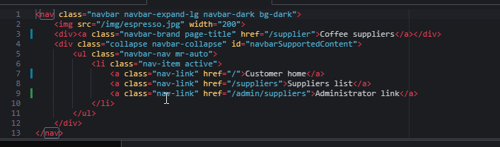

-   `customer/views/supplier-list-all.html` was changed to remove
    supplier add/edit controls.
    
    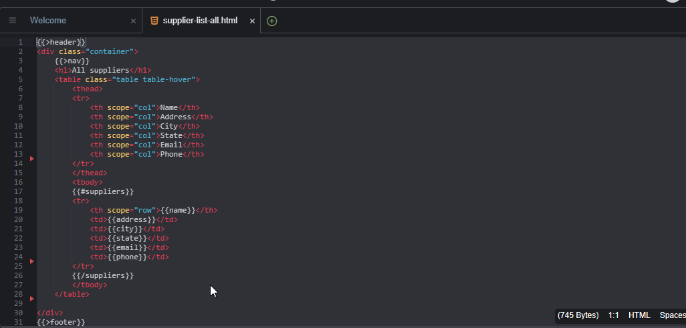

-   The customer templates `customer/views/supplier-add.html`,
    `customer/views/supplier-form-fields.html`, and
    `customer/views/supplier-update.html` were deleted.

    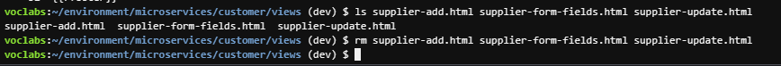

### Application entry point

File: `customer/index.js`

The customer routes were adjusted to remove customer-side write routes,
and the default application port was changed to `8080`.

## 5. Task 4.3: Create the customer microservice Dockerfile and launch a test container

### Dockerfile

The recorded customer Dockerfile is:

``` dockerfile
FROM node:11-alpine

RUN mkdir -p /usr/src/app
WORKDIR /usr/src/app

COPY . .

RUN npm install

EXPOSE 8080

CMD ["npm", "run", "start"]
```

  -----------------------------------------------------------------------
  Instruction                         Purpose
  ----------------------------------- -----------------------------------
  `FROM`                              Selects the Node.js Alpine base
                                      image.

  `RUN mkdir`                         Creates the application directory
                                      in the image.

  `WORKDIR`                           Sets the working directory for
                                      subsequent instructions and the
                                      default command.

  `COPY . .`                          Copies the build context into the
                                      image.

  `RUN npm install`                   Installs the application's Node.js
                                      dependencies.

  `EXPOSE 8080`                       Documents the expected container
                                      port; it does not publish the host
                                      port.

  `CMD`                               Starts the application using its
                                      npm start script.
  -----------------------------------------------------------------------

The Docker `-p` option publishes a host port and forwards traffic to a
container port. `EXPOSE` alone does not do that.

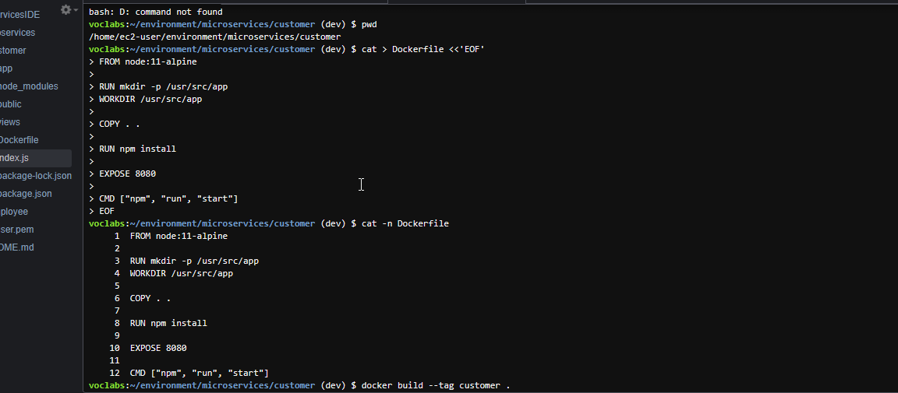

### Build and run

``` bash
cd ~/environment/microservices/customer
docker build --tag customer .
```
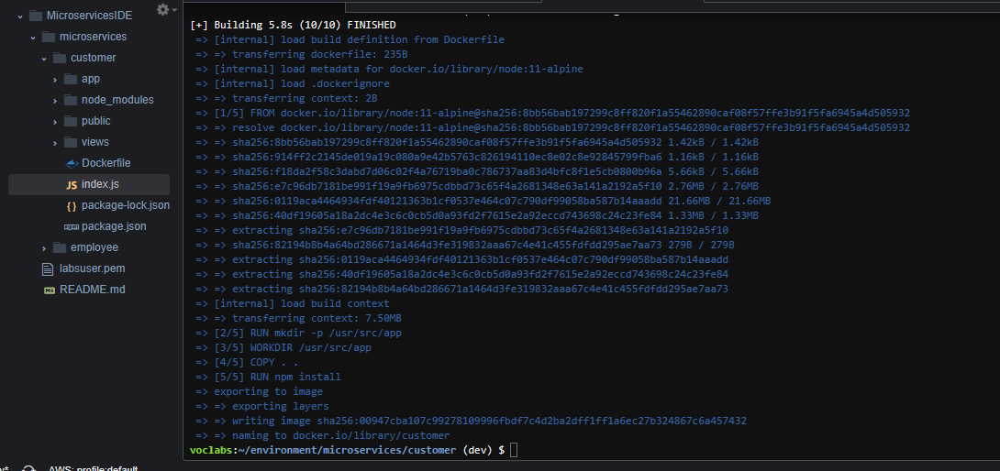

The first test launch omitted `APP_DB_HOST`, causing the application to
attempt a connection to `127.0.0.1:3306` and receive a
connection-refused error. The container was relaunched with the database
endpoint passed in an environment variable.

From the customer directory:

``` bash
dbEndpoint=$(grep 'APP_DB_HOST' app/config/config.js | cut -d '"' -f2)

docker run -d \
  --name customer_1 \
  -p 8080:8080 \
  -e APP_DB_HOST="$dbEndpoint" \
  customer
```
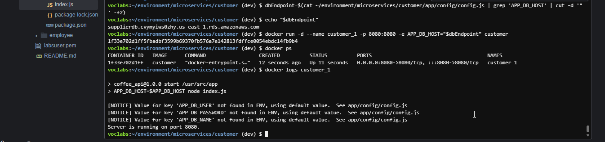

### Verification

``` bash
curl -s http://localhost:8080/suppliers/
docker ps
docker logs customer_1
```

The recorded `curl` request returned HTTP 200 HTML containing supplier
records, including **Kenya Coffee** and **Western Coffee**. The final
customer-facing list did not display administrative add/edit controls.

A running container alone does not prove that the application or its
database connection works; testing an application route is important.

**Status:** customer image built, container launched, database endpoint
issue corrected, and supplier-list response verified.

## 6. Task 4.4: Modify the source code of the employee microservice

### Controller and routes

File: `employee/app/controller/supplier.controller.js`

Redirects were changed so administrative operations return to
`/admin/suppliers`.

File: `employee/index.js`

The recorded route patterns are:

``` javascript
app.get("/admin", ...);
app.get("/admin/suppliers/", supplier.findAll);
app.get("/admin/supplier-add", ...);
app.post("/admin/supplier-add", supplier.create);
app.get("/admin/supplier-update/:id", supplier.findOne);
app.post("/admin/supplier-update", supplier.update);
app.post("/admin/supplier-remove/:id", supplier.remove);
```

The ellipses are explanatory placeholders for existing handlers, not
literal code to paste into the application.

  Route                               Purpose
  ----------------------------------- ------------------------------
  `GET /admin/suppliers/`             Display the supplier list.
  `GET /admin/supplier-add`           Display the add form.
  `POST /admin/supplier-add`          Submit a new supplier.
  `GET /admin/supplier-update/:id`    Load a supplier for editing.
  `POST /admin/supplier-update`       Submit supplier updates.
  `POST /admin/supplier-remove/:id`   Remove a supplier.

The initial employee default port was:

``` javascript
const app_port = process.env.APP_PORT || 8081
```

Task 4.6 later changed the default to `8080`.

### Employee views and navigation

The following files were updated:

-   `employee/views/header.html` --- heading changed to
    `Manage coffee suppliers`.
-   `employee/views/home.html` --- administrative supplier-list link
    updated.
-   `employee/views/nav.html` --- administrative navigation and
    customer-home link updated.
-   `employee/views/supplier-add.html` --- add form action changed to
    `/admin/supplier-add`.
-   `employee/views/supplier-list-all.html` --- add and edit links
    updated to administrative paths.
-   `employee/views/supplier-update.html` --- update and remove form
    actions updated.

Recorded form action patterns include:

``` html
<form action="/admin/supplier-add" method="POST">
```

``` html
<form action="/admin/supplier-update" method="POST">
```

``` html
<form action="/admin/supplier-remove/{{id}}" method="POST">
```

These are route examples, not complete replacement templates.

The employee navigation includes a Customer home link to `/`. During the
isolated port-`8081` test, cross-service links may not work because the
customer and employee services are not yet integrated behind the later
load-balancer architecture.

### Syntax validation

These checks passed:

``` bash
node --check index.js
node --check app/controller/supplier.controller.js
```

## 7. Task 4.5: Create the employee microservice Dockerfile and launch a test container

### Initial employee Dockerfile

The employee Dockerfile was copied from the customer Dockerfile and
adjusted for the initial port-`8081` test:

``` dockerfile
FROM node:11-alpine

RUN mkdir -p /usr/src/app
WORKDIR /usr/src/app

COPY . .

RUN npm install

EXPOSE 8081

CMD ["npm", "run", "start"]
```

Build the image:

``` bash
cd ~/environment/microservices/employee
docker build --tag employee .
```

The initial employee test container used the name `employee_1`,
published port `8081`, and received the database endpoint:

``` bash
docker run -d \
  --name employee_1 \
  -p 8081:8081 \
  -e APP_DB_HOST="$dbEndpoint" \
  employee
```

### Browser test

The project guide specifies the URL pattern:

``` text
http://<cloud9-public-ip-address>:8081/admin/suppliers
```

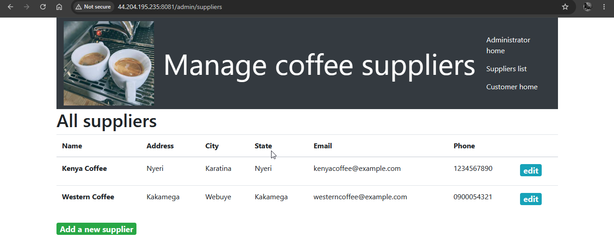

The prescribed tests are:

1.  Open the administrative supplier list.
2.  Confirm Add and Edit controls are visible.
3.  Add a test supplier and verify it appears.
4.  Edit a supplier and verify the updated data appears.
5.  Delete a test supplier and verify it no longer appears.
6.  Inspect running containers with `docker ps`.

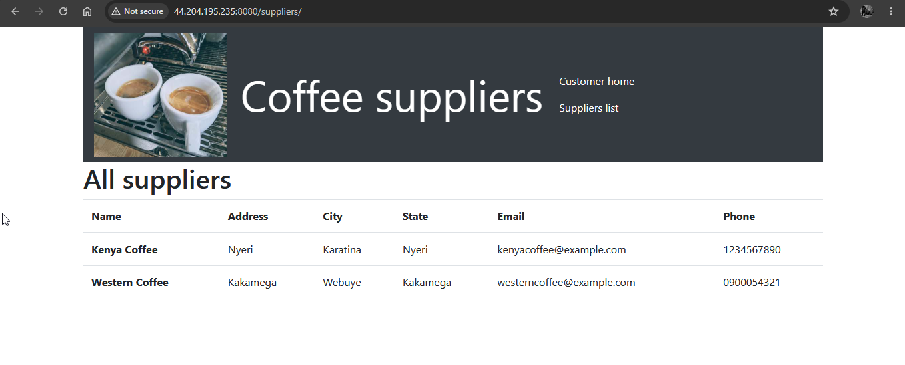


## 8. Task 4.6: Adjust the employee microservice port and rebuild the image

### Change the port

The project guide specifies port `8080` for the employee service in the
later ECS deployment configuration. These commands were run:

``` bash
cd ~/environment/microservices/employee

sed -i 's/|| 8081/|| 8080/' index.js
sed -i 's/EXPOSE 8081/EXPOSE 8080/' Dockerfile
```

The first changes the application's default listening port; the second
changes the Dockerfile declaration.

### Remove the old container and rebuild

``` bash
docker rm -f employee_1
docker build --tag employee .
```

Rebuilding an image does not automatically replace a container already
created from the previous image. The old container was removed as the
guide instructed. A replacement employee test container was not launched
for this task.

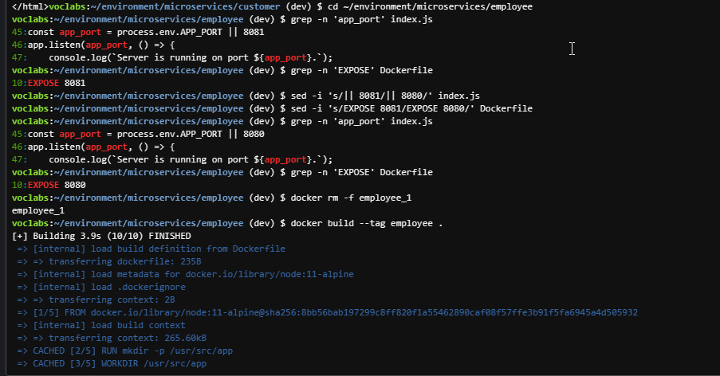

## 9. Task 4.7: Check code into CodeCommit

### Review and stage

The repository is `microservices`, branch `dev`, remote `origin`, in AWS
Region `us-east-1`.

``` bash
cd ~/environment/microservices
git status
git diff --check
git diff --stat
git add customer employee
git status
git diff --cached --check
git diff --cached --stat
```

These commands check the worktree, review unstaged changes, stage the
customer and employee directories, and review the staged changes before
committing.

### Commit and push

The commit command was:

``` bash
git commit -m "Configure customer and employee microservices"
```

Recorded commit:

``` text
8f1739c
```

Then the changes were pushed:

``` bash
git push origin dev
```

The push confirmed that remote branch `dev` was updated from `25861e7`
to `8f1739c`.

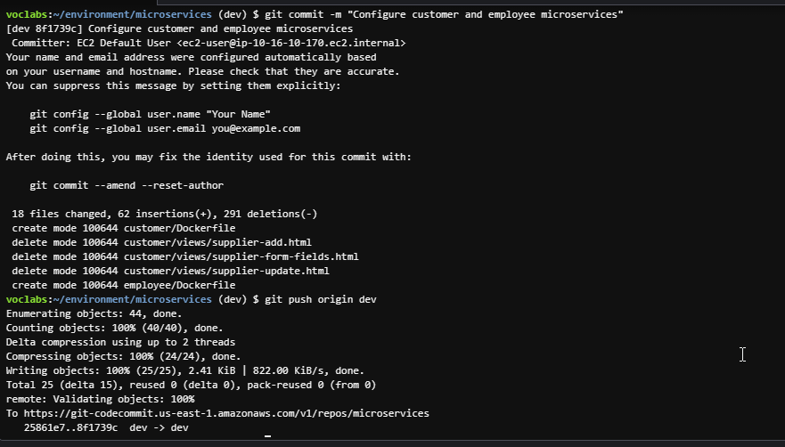

### Final Git verification

``` bash
git status
```

Recorded output:

``` text
On branch dev
Your branch is up to date with 'origin/dev'.

nothing to commit, working tree clean
```
