# Phase 5 — ECR Repositories, ECS Cluster, Task Definitions, and AppSpec Files

## Project metadata

| Item | Value |
|---|---|
| Project | Building Microservices and a CI/CD Pipeline with AWS |
| Phase | Phase 5 |
| Region | `us-east-1` |
| ECS cluster | `microservices-serverlesscluster` |
| ECR repositories | `customer`, `employee` |
| Deployment CodeCommit repository | `deployment` |
| Git branch | `dev` |
| Working directory | `/home/ec2-user/environment/deployment` |
| Database endpoint configured in task definitions | `supplierdb.cvymyiws0zhy.us-east-1.rds.amazonaws.com` |

## 1. Phase 5 overview

Phase 5 prepares the image registry, ECS cluster, and deployment templates needed to deploy the two microservices later in the project.

The two microservices are:

- **Customer microservice (`customer`)** — intended to provide read-only supplier functionality.
- **Employee microservice (`employee`)** — intended to provide employee-facing supplier management functionality.

The phase covers six tasks:

1. Task 5.1 — Create ECR repositories and upload Docker images.
2. Task 5.2 — Create an ECS cluster.
3. Task 5.3 — Create a CodeCommit repository to store deployment files.
4. Task 5.4 — Create task definition files for each microservice and register them with Amazon ECS.
5. Task 5.5 — Create AppSpec files for CodeDeploy for each microservice.
6. Task 5.6 — Update files and check them into CodeCommit.

## 2. Learning objectives

By completing this phase, a learner should be able to:

- Store container images in Amazon Elastic Container Registry (ECR).
- Explain the roles of an ECS cluster, task definition, task, service, and container.
- Create an ECS cluster for a Fargate-based deployment.
- Maintain deployment templates in a separate Git repository.
- Define container settings, environment variables, resource requirements, and logging in ECS task definition JSON.
- Describe how CodeDeploy uses AppSpec files for ECS blue/green deployments.
- Use an image placeholder in a pipeline-oriented task definition template.


## 3. Architecture and resource relationships

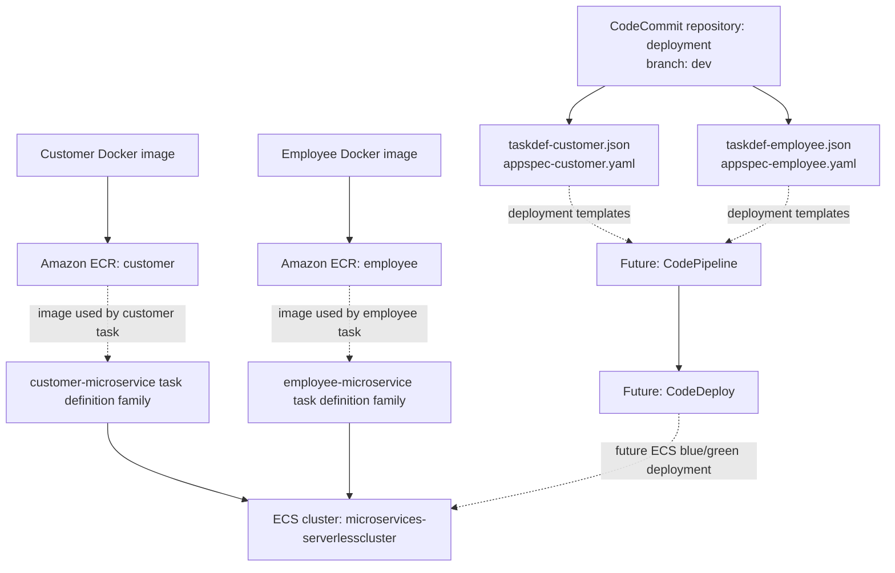

**Phase 5 resources and artifacts:** ECR repositories and images, the ECS cluster, registered task definition revisions, the CodeCommit deployment repository, and the four deployment files.

**Later-phase resources:** the target groups and Application Load Balancer (Phase 6), ECS services (Phase 7), and CodeDeploy deployment groups and CodePipeline pipelines (Phase 8).

Useful initial checks:

```bash
aws sts get-caller-identity
aws configure get region
docker images
```
---

## 5. Task 5.1 — Create ECR repositories and upload Docker images

### Purpose

Amazon ECR is a managed container image registry. The project uses separate repositories so the customer and employee microservice images can be stored and versioned independently.

The expected image destinations are:

- `accountid.dkr.ecr.us-east-1.amazonaws.com/customer:latest`
- `accountid.dkr.ecr.us-east-1.amazonaws.com/employee:latest`

### Understand the image URI

For example:

`accountid.dkr.ecr.us-east-1.amazonaws.com/customer:latest`

| Component | Meaning |
|---|---|
| `bunchofnumbers` | AWS account ID that owns the registry |
| `dkr.ecr` | ECR Docker registry endpoint |
| `us-east-1` | AWS Region |
| `customer` | Repository name |
| `latest` | Image tag |

The `latest` tag is a mutable label, not a guarantee that the image is the newest or safest version. For controlled releases, immutable version tags or image digests are often more reliable.

### Create the repositories

The repositories were created as private ECR repositories named `customer` and `employee`. If reproducing the task with the CLI and the repositories do not already exist, the commands are:

```bash
aws ecr create-repository --repository-name customer --region us-east-1
aws ecr create-repository --repository-name employee --region us-east-1
```

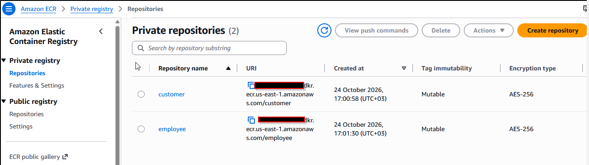

### Authenticate Docker to ECR

```bash
aws ecr get-login-password --region us-east-1 \
  | docker login --username AWS --password-stdin \
  accountid.dkr.ecr.us-east-1.amazonaws.com
```

A successful login normally reports `Login Succeeded`.

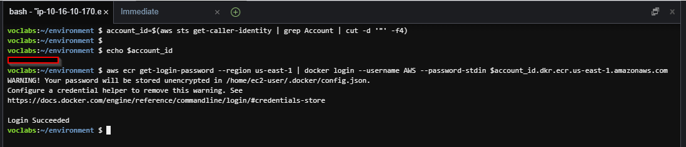

### Tag and push the images

These commands assume the local images are tagged `customer:latest` and `employee:latest`.

```bash
docker tag customer:latest \
  accountid.dkr.ecr.us-east-1.amazonaws.com/customer:latest

docker tag employee:latest \
  accountid.dkr.ecr.us-east-1.amazonaws.com/employee:latest
```
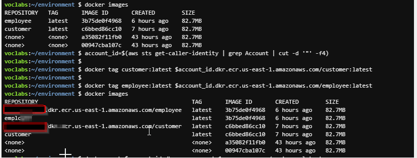

### Verify the images

```bash
aws ecr describe-images \
  --repository-name customer \
  --region us-east-1

aws ecr describe-images \
  --repository-name employee \
  --region us-east-1
```

Expected result: each repository has an image tagged `latest`. The lab push completed successfully.

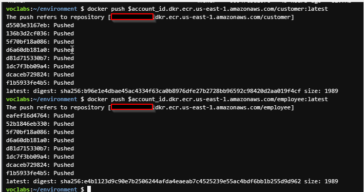


### Repository policy security note

The lab guide used a repository policy with a wildcard principal (`"Principal": "*"`) and broad ECR permissions (`"Action": "ecr:*"`). This is overly permissive and is documented here only as a lab-specific configuration. Do not copy it into production.

In production, use least privilege: grant only the required actions to specific trusted principals, and review whether a repository policy is needed at all. Avoid public or wildcard access unless a deliberate, reviewed public distribution design requires it.

---

## 6. Task 5.2 — Create an ECS cluster

### Purpose and terminology

Amazon Elastic Container Service (ECS) orchestrates containerized applications.

- **Cluster:** logical place where ECS services and tasks are grouped.
- **Task definition:** blueprint specifying the containers, images, CPU/memory, networking, environment, and logging configuration.
- **Task:** a running instance of a task definition.
- **Container:** the application process packaged and run from an image.
- **Service:** maintains the desired number of tasks and supports deployment and recovery behavior.
- **AWS Fargate:** a serverless compute option for containers; AWS manages the underlying server infrastructure.

### Completed cluster

The cluster was created successfully:

- Name: `microservices-serverlesscluster`
- ARN: `arn:aws:ecs:us-east-1:accountid:cluster/microservices-serverlesscluster`
- Status: `ACTIVE`

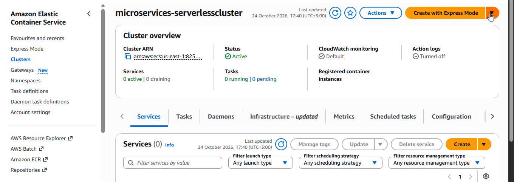

An empty cluster with zero services and zero running tasks was expected at this point. The cluster's creation did not itself deploy the microservices.

---

## 7. Task 5.3 — Create a CodeCommit repository for deployment files

### Purpose

The project keeps deployment artifacts separate from the application source repository. The `deployment` repository stores task definition templates and AppSpec files that later stages of the pipeline will use.

The CodeCommit repository `deployment` exists in `us-east-1`. The local Git repository is at `~/environment/deployment`, and its branch is `dev`.

### Local repository setup

The local repository was initialized with:

```bash
cd ~/environment
mkdir deployment
cd deployment
git init -b dev
```

The remote was configured with:

```bash
git remote add origin https://git-codecommit.us-east-1.amazonaws.com/v1/repos/deployment
```

Only run `git remote add` if the remote has not already been configured. If `origin` already exists, inspect it with `git remote -v` rather than adding a duplicate.

### Verify the local and remote configuration

```bash
git branch --show-current
git remote -v
git status
```

Expected branch: `dev`.

Expected remote:

```text
origin  https://git-codecommit.us-east-1.amazonaws.com/v1/repos/deployment (fetch)
origin  https://git-codecommit.us-east-1.amazonaws.com/v1/repos/deployment (push)
```

A configured remote URL does not by itself prove that authentication or a push will succeed. Successful push verification is recorded in Task 5.6.

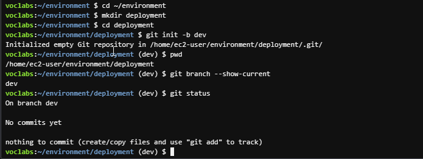

---

## 8. Task 5.4 — Create task definition files for each microservice

### Purpose

An ECS task definition specifies how ECS should run a containerized workload. Each microservice has its own task definition family so its image and configuration can be managed independently.

The files are:

- `taskdef-customer.json`
- `taskdef-employee.json`

### Established configuration

| Setting | Customer | Employee |
|---|---|---|
| Task definition family | `customer-microservice` | `employee-microservice` |
| Container name at registration | `customer` | `employee` |
| Compatibility | `FARGATE` | `FARGATE` |
| Network mode | `awsvpc` | `awsvpc` |
| CPU | `512` | `512` |
| Memory | `1024` MiB | `1024` MiB |
| Container port | `8080` | `8080` |
| Execution role | `PipelineRole` | `PipelineRole` |
| Database endpoint | `supplierdb.cvymyiws0zhy.us-east-1.rds.amazonaws.com` | Same endpoint |
| CloudWatch log group | `awslogs-capstone` | `awslogs-capstone` |

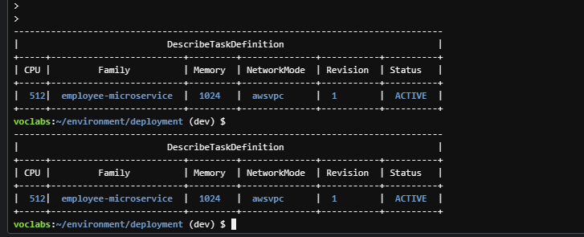


### Important task definition fields

| Field | Purpose |
|---|---|
| `family` | Name grouping revisions of a task definition |
| `networkMode` | `awsvpc` gives each task its own network interface |
| `requiresCompatibilities` | Declares that the task definition supports `FARGATE` |
| `cpu` | CPU allocation for the task |
| `memory` | Memory allocation for the task |
| `executionRoleArn` | Role ECS/Fargate uses for actions such as pulling images and sending logs |
| `containerDefinitions` | Container-level configuration |
| `name` | Container name referenced by deployment configuration |
| `image` | Image URI used to start the container; later replaced by a pipeline placeholder in the templates |
| `portMappings` | Container port mapping |
| `environment` | Non-secret runtime configuration, including `APP_DB_HOST` |
| `logConfiguration` | Sends container logs to CloudWatch Logs |

The database endpoint is configuration information; it is not a database password. No database credentials should be committed to Git.

### Validate the JSON files

From the deployment directory:

```bash
python3 -m json.tool taskdef-customer.json
python3 -m json.tool taskdef-employee.json
```

A valid JSON file is formatted and printed without a parsing error. For a quiet validation:

```bash
python3 -m json.tool taskdef-customer.json > /dev/null && echo "Customer JSON valid"
python3 -m json.tool taskdef-employee.json > /dev/null && echo "Employee JSON valid"
```
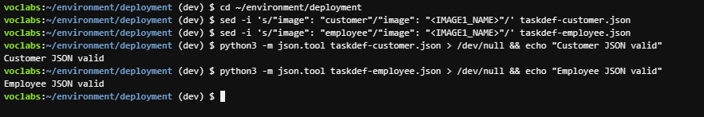

### Registering task definitions

The original task definition files were registered successfully before their image fields were changed to pipeline placeholders. The registered revisions are:

- `customer-microservice:1` — `ACTIVE`
- `employee-microservice:1` — `ACTIVE`

The task definition family is the stable family name; the revision is a numbered version within that family. Registering a changed definition normally creates a new revision.

To inspect the existing registered revisions:

```bash
aws ecs describe-task-definition \
  --task-definition customer-microservice:1 \
  --region us-east-1

aws ecs describe-task-definition \
  --task-definition employee-microservice:1 \
  --region us-east-1
```

For a concise view:

```bash
aws ecs describe-task-definition \
  --task-definition customer-microservice:1 \
  --region us-east-1 \
  --query 'taskDefinition.[family,revision,status,cpu,memory,networkMode]' \
  --output table

aws ecs describe-task-definition \
  --task-definition employee-microservice:1 \
  --region us-east-1 \
  --query 'taskDefinition.[family,revision,status,cpu,memory,networkMode]' \
  --output table
```

**Important:** Later in Task 5.6, the JSON templates in the Git repository are changed to contain `<IMAGE1_NAME>`. Do not register these placeholder-based templates as new ECS task definitions. The placeholder is for the pipeline template, not a real container image URI.

---

## 9. Task 5.5 — Create AppSpec files for CodeDeploy

### Purpose

An AppSpec file tells CodeDeploy which ECS service resource to update and which container/port the load balancer targets during an ECS deployment. The customer and employee microservices need separate files because their container names differ.

Files:

- `appspec-customer.yaml`
- `appspec-employee.yaml`

### Customer AppSpec

```yaml
version: 0.0

Resources:
 - TargetService:
    Type: AWS::ECS::Service
    Properties:
     TaskDefinition: <TASK_DEFINITION>
     LoadBalancerInfo:
      ContainerName: "customer"
      ContainerPort: 8080
```

### Employee AppSpec

```yaml
version: 0.0

Resources:
 - TargetService:
    Type: AWS::ECS::Service
    Properties:
     TaskDefinition: <TASK_DEFINITION>
     LoadBalancerInfo:
      ContainerName: "employee"
      ContainerPort: 8080
```

The container name must match the container name in the respective task definition. The port must match the configured container port.

Leave `<TASK_DEFINITION>` unchanged in these pipeline templates. The deployment pipeline replaces the placeholder with the task definition revision used for a deployment. Do not manually replace it with an ARN in the committed AppSpec template.

### Verify the files

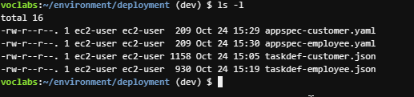

YAML indentation matters. Keep the indentation consistent with the lab guide.

---

## 10. Task 5.6 — Update files and check them into CodeCommit

### Replace the image fields with the pipeline placeholder

The pipeline template needs a placeholder where the image source action can supply the actual image URI. The two task definition files were updated using:

```bash
sed -i 's/"image": "customer"/"image": "<IMAGE1_NAME>"/' taskdef-customer.json
sed -i 's/"image": "employee"/"image": "<IMAGE1_NAME>"/' taskdef-employee.json
```

Verify:

```bash
grep '"image"' taskdef-customer.json taskdef-employee.json
```

Expected relevant output:

```text
taskdef-customer.json:            "image": "<IMAGE1_NAME>",
taskdef-employee.json:            "image": "<IMAGE1_NAME>",
```

Validate the modified files again:

```bash
python3 -m json.tool taskdef-customer.json > /dev/null && echo "Customer JSON valid"
python3 -m json.tool taskdef-employee.json > /dev/null && echo "Employee JSON valid"
```

The placeholder is intended for the pipeline's deployment template. It is not a valid real image URI to use when launching a task manually.

### Stage, commit, and push

The four deployment files were staged, committed, and pushed:

```bash
git add taskdef-customer.json taskdef-employee.json appspec-customer.yaml appspec-employee.yaml
git status
git commit -m "Add ECS deployment task definitions and AppSpec files"
git push -u origin dev
git status
```

### What the Git commands do

- `git add` stages the selected files for the next commit.
- `git status` shows staged, unstaged, and untracked changes.
- `git commit` saves a local snapshot of the staged files.
- `git push -u origin dev` uploads the `dev` branch to the `origin` remote and configures upstream tracking.
- A clean final `git status` means no uncommitted changes remain and the branch is synchronized with its configured upstream, assuming the command reports it is up to date.

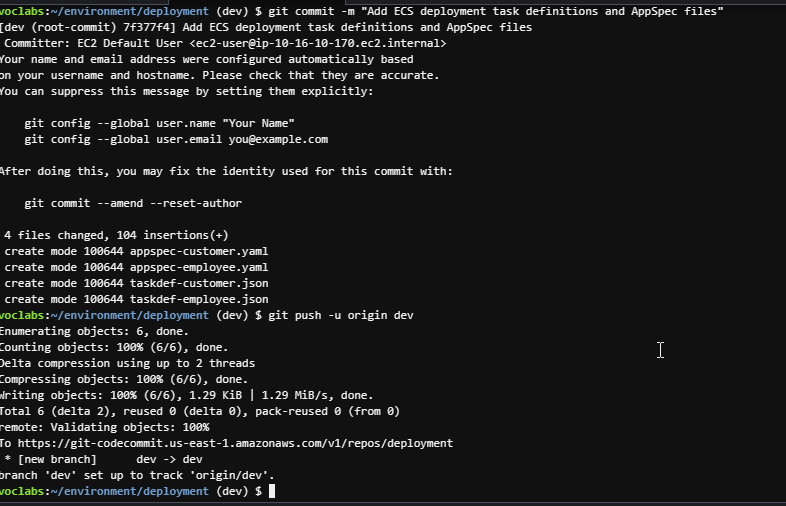

### Verified result

| Item | Confirmed result |
|---|---|
| Commit | `7f377f4` |
| Commit message | `Add ECS deployment task definitions and AppSpec files` |
| Branch | `dev` |
| Remote | `origin` |
| Push | Successful |
| Final working tree | Clean |
| Files committed | Four |

Git displayed an automatically generated committer identity notice. This notice did not prevent the commit or the push; the remote accepted the commit.

The four files in the commit are:

- `taskdef-customer.json`
- `taskdef-employee.json`
- `appspec-customer.yaml`
- `appspec-employee.yaml`

---